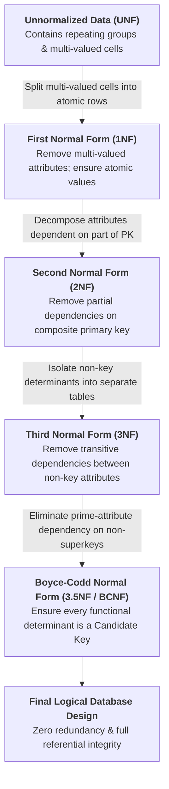
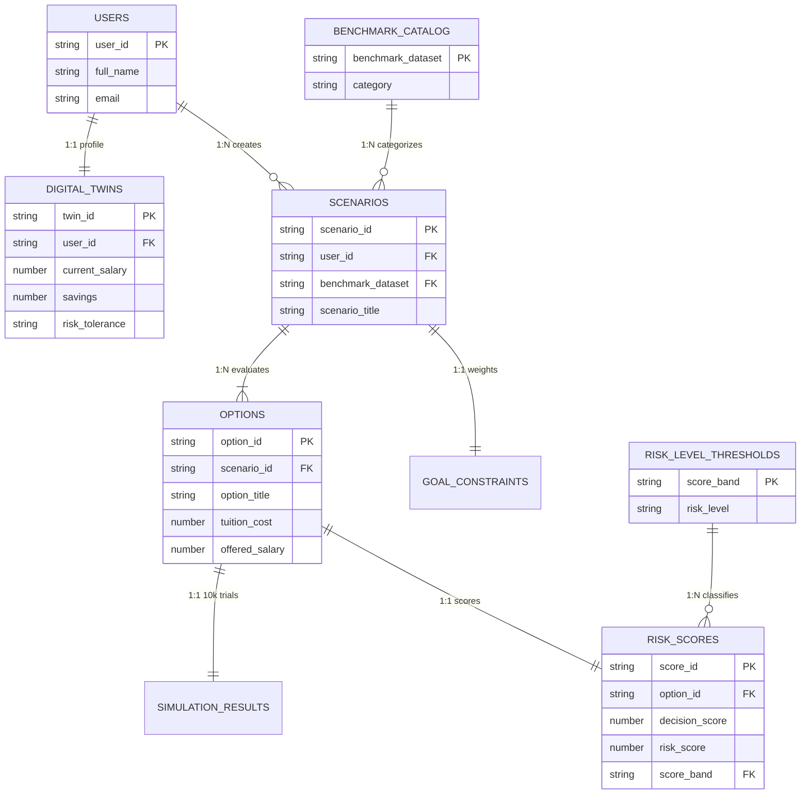

# Database Normalization Specification (UNF → 1NF → 2NF → 3NF → 3.5NF / BCNF)
**Project:** DecisionTwin — Intelligent Decision Simulation & Risk Analytics Platform

---

## 1. Overview & Objectives of Database Normalization

Database normalization in **DecisionTwin** structures user personas, decision scenarios, competing alternatives, and 10,000-trial Monte Carlo simulation results into logically independent relations to achieve:

- **Elimination of Data Redundancy**: Prevents repeating user demographic, salary, and scenario metadata across hundreds of simulation records.
- **Prevention of Data Anomalies**:
  - *Insertion Anomaly*: Ability to register a user or benchmark dataset before any scenario is created.
  - *Update Anomaly*: Updating a user's salary or email in one place without scanning every historical option row.
  - *Deletion Anomaly*: Deleting a temporary "What-If" option without losing the parent scenario or user profile.
- **Removal of Undesirable Dependencies**: Eliminates partial, transitive, and non-superkey functional dependencies.
- **Improved Maintainability & Query Performance**: Enables clean indexing on primary and foreign keys (`user_id`, `scenario_id`, `option_id`).

### Normalization Progression Flow

---

## 2. Before vs. After Normalization Summary

| Before Normalization (`UnnormalizedDecisionRecord`) | After Normalization (Up to 3.5NF / BCNF) |
| :--- | :--- |
| **Single Flat Record Structure:** • `user_id` • `full_name` • `email` • `current_salary` • `risk_tolerance` • `scenario_id` • `scenario_title` • `category` • `benchmark_dataset` • `options_evaluated` *(comma-separated list)* • `decision_scores` *(comma-separated list)* • `risk_scores` *(comma-separated list)* • `risk_levels` *(comma-separated list)* | **Decomposed Relational Tables:** 1. **Users**: `(user_id [PK], full_name, email)` 2. **DigitalTwins**: `(twin_id [PK], user_id [FK], current_salary, risk_tolerance)` 3. **BenchmarkCatalog**: `(benchmark_dataset [PK], category)` 4. **Scenarios**: `(scenario_id [PK], user_id [FK], scenario_title, benchmark_dataset [FK])` 5. **Options**: `(option_id [PK], scenario_id [FK], option_title, tuition_cost)` 6. **RiskScores**: `(score_id [PK], option_id [FK], decision_score, risk_score)` 7. **RiskLevelThresholds**: `(risk_score_range [PK], risk_level)` |
| **Core Problems:** • User details repeat for every scenario and option. • Multi-valued lists (`options_evaluated`, `decision_scores`) prevent indexing and atomic querying. | **Outcome:** • Strictly atomic cells (1NF) • Full key dependency (2NF) • Zero transitive dependency (3NF) • Every determinant is a candidate key (3.5NF / BCNF) |

---

## 3. Stage 0: Unnormalized Data (UNF)

In the **Unnormalized Form (UNF)**, all user profile attributes, scenario metadata, and evaluated options are stored in a single flat table, with multiple values packed into single cells.

### Table: `UnnormalizedDecisionRecords` (UNF)

| User ID | Name | Email | Salary | Risk Tol. | Scenario ID | Scenario Title | Category | Benchmark Dataset | Options Evaluated *(Multi-Valued)* | Decision Scores *(Multi-Valued)* | Risk Scores *(Multi-Valued)* | Risk Levels *(Multi-Valued)* |
| :--- | :--- | :--- | :--- | :--- | :--- | :--- | :--- | :--- | :--- | :--- | :--- | :--- |
| **U001** | Preetish | preetish@mail.com | ₹12,00,000 | Moderate | **S001** | MBA vs SWE | Career | `IT_MNC_Comp_2026` | Tier-1 MBA, Senior SWE, AI Startup | 80, 89, 83 | 48, 21, 34 | Medium, Low, Low |
| **U001** | Preetish | preetish@mail.com | ₹12,00,000 | Moderate | **S002** | Master in AI | Education | `NIRF_HigherEd_2026` | Full-Time MS, Executive MS | 84, 86 | 52, 25 | Medium, Low |
| **U002** | Priya | priya@mail.com | ₹8,00,000 | Low | **S003** | Job Switch | Career | `IT_MNC_Comp_2026` | Fintech MNC, Remote Startup | 78, 72 | 28, 68 | Low, High |
| **U003** | Karthik | karthik@mail.com | ₹15,00,000 | High | **S004** | SaaS Venture | Startup | `Venture_Index_2026` | Bootstrapped, Seed Funded | 75, 88 | 42, 30 | Medium, Low |

### Violations & Anomalies in UNF:
1. **Multi-Valued Attributes**: `Options Evaluated`, `Decision Scores`, `Risk Scores`, and `Risk Levels` store comma-separated lists in a single cell.
2. **Data Redundancy**: `Preetish`, `preetish@mail.com`, and `₹12,00,000` are duplicated across rows `S001` and `S002`.
3. **Update Anomaly**: Changing `U001`'s salary requires updating multiple rows; missing one row corrupts data consistency.

---

## 4. Stage 1: First Normal Form (1NF)

> **1NF Rule:** A relation is in **First Normal Form (1NF)** if and only if every attribute contains only **atomic (indivisible) values**, and there are no repeating groups.

### Step 4.1: Identifying the 1NF Violation

| Scenario ID | User ID | Name | Scenario Title | Options Evaluated *(Non-Atomic)* | Decision Scores *(Non-Atomic)* |
| :--- | :--- | :--- | :--- | :--- | :--- |
| **S001** | U001 | Preetish | MBA vs SWE | Tier-1 MBA, Senior SWE, AI Startup | 80, 89, 83 |
| **S002** | U001 | Preetish | Master in AI | Full-Time MS, Executive MS | 84, 86 |

*Violation:* Multiple options and scores are packed into single cells.

### Step 4.2: Converting to 1NF (Flattening into Atomic Rows)

Each evaluated option is placed into its own separate row, and a unique `Option ID` is assigned.

#### Table: `ScenarioOptionRecords_1NF`
**Composite Primary Key:** `(Scenario ID, Option ID)`

| Scenario ID (PK) | Option ID (PK) | User ID | Name | Email | Salary | Scenario Title | Category | Benchmark Dataset | Option Title | Decision Score | Risk Score | Risk Level |
| :--- | :--- | :--- | :--- | :--- | :--- | :--- | :--- | :--- | :--- | :--- | :--- | :--- |
| **S001** | **OPT01** | U001 | Preetish | preetish@mail.com | ₹12L | MBA vs SWE | Career | `IT_MNC_Comp_2026` | Tier-1 MBA | 80 | 48 | Medium |
| **S001** | **OPT02** | U001 | Preetish | preetish@mail.com | ₹12L | MBA vs SWE | Career | `IT_MNC_Comp_2026` | Senior SWE | 89 | 21 | Low |
| **S001** | **OPT03** | U001 | Preetish | preetish@mail.com | ₹12L | MBA vs SWE | Career | `IT_MNC_Comp_2026` | AI Startup | 83 | 34 | Low |
| **S002** | **OPT04** | U001 | Preetish | preetish@mail.com | ₹12L | Master in AI | Education | `NIRF_HigherEd_2026` | Full-Time MS | 84 | 52 | Medium |
| **S002** | **OPT05** | U001 | Preetish | preetish@mail.com | ₹12L | Master in AI | Education | `NIRF_HigherEd_2026` | Executive MS | 86 | 25 | Low |
| **S003** | **OPT06** | U002 | Priya | priya@mail.com | ₹8L | Job Switch | Career | `IT_MNC_Comp_2026` | Fintech MNC | 78 | 28 | Low |
| **S003** | **OPT07** | U002 | Priya | priya@mail.com | ₹8L | Job Switch | Career | `IT_MNC_Comp_2026` | Remote Startup | 72 | 68 | High |

---

## 5. Stage 2: Second Normal Form (2NF)

> **2NF Rule:** A relation is in **Second Normal Form (2NF)** if it is in 1NF and **every non-prime attribute is fully functionally dependent on the entire composite primary key** (no partial dependencies).

### Step 5.1: Identifying Partial Dependencies in 1NF

In `ScenarioOptionRecords_1NF`, the composite primary key is **`(Scenario ID, Option ID)`**:

1. **Full Dependency (Valid):**
   $$(\text{Scenario ID}, \text{Option ID}) \to \{\text{Option Title, Decision Score, Risk Score, Risk Level}\}$$
2. **Partial Dependency (Violates 2NF):**
   $$\text{Scenario ID} \to \{\text{Scenario Title, Category, Benchmark Dataset, User ID, Name, Email, Salary}\}$$
   *(These attributes depend only on `Scenario ID` and have nothing to do with `Option ID`.)*

### Step 5.2: Converting to 2NF (Decomposition)

We split the 1NF table into two tables to eliminate partial dependencies:

#### Table 1: `Scenarios_2NF`
**Primary Key:** `Scenario ID`

| Scenario ID (PK) | User ID | Name | Email | Salary | Scenario Title | Category | Benchmark Dataset |
| :--- | :--- | :--- | :--- | :--- | :--- | :--- | :--- |
| **S001** | U001 | Preetish | preetish@mail.com | ₹12,00,000 | MBA vs SWE | Career | `IT_MNC_Comp_2026` |
| **S002** | U001 | Preetish | preetish@mail.com | ₹12,00,000 | Master in AI | Education | `NIRF_HigherEd_2026` |
| **S003** | U002 | Priya | priya@mail.com | ₹8,00,000 | Job Switch | Career | `IT_MNC_Comp_2026` |
| **S004** | U003 | Karthik | karthik@mail.com | ₹15,00,000 | SaaS Venture | Startup | `Venture_Index_2026` |

#### Table 2: `Options_2NF`
**Primary Key:** `Option ID` | **Foreign Key:** `Scenario ID`

| Option ID (PK) | Scenario ID (FK) | Option Title | Decision Score | Risk Score | Risk Level |
| :--- | :--- | :--- | :--- | :--- | :--- |
| **OPT01** | S001 | Tier-1 MBA | 80 | 48 | Medium |
| **OPT02** | S001 | Senior SWE | 89 | 21 | Low |
| **OPT03** | S001 | AI Startup | 83 | 34 | Low |
| **OPT04** | S002 | Full-Time MS | 84 | 52 | Medium |
| **OPT05** | S002 | Executive MS | 86 | 25 | Low |
| **OPT06** | S003 | Fintech MNC | 78 | 28 | Low |
| **OPT07** | S003 | Remote Startup | 72 | 68 | High |

---

## 6. Stage 3: Third Normal Form (3NF)

> **3NF Rule:** A relation is in **Third Normal Form (3NF)** if it is in 2NF and contains **no transitive dependencies** (no non-prime attribute depends on another non-prime attribute).

### Step 6.1: Identifying Transitive Dependencies in 2NF

1. **In `Scenarios_2NF`:**
   $$\text{Scenario ID (PK)} \to \text{User ID (Non-Key)} \to \{\text{Name, Email, Salary}\}$$
   *Violation:* `Name`, `Email`, and `Salary` depend on `User ID`, which is not the primary key of `Scenarios_2NF`.
2. **In `Options_2NF`:**
   $$\text{Option ID (PK)} \to \text{Risk Score (Non-Key)} \to \text{Risk Level (Non-Key)}$$
   *Violation:* `Risk Level` (`Low` for $<40$, `Medium` for $40\text{–}64$, `High` for $\ge 65$) is transitively determined by `Risk Score`.

### Step 6.2: Converting to 3NF (Decomposition)

We extract the transitive determinants into their own dedicated tables:

#### Table 1: `Users_3NF`
**Primary Key:** `User ID`

| User ID (PK) | Name | Email |
| :--- | :--- | :--- |
| **U001** | Preetish | preetish@mail.com |
| **U002** | Priya | priya@mail.com |
| **U003** | Karthik | karthik@mail.com |

#### Table 2: `DigitalTwins_3NF`
**Primary Key:** `Twin ID` | **Foreign Key:** `User ID` (1:1)

| Twin ID (PK) | User ID (FK) | Current Salary | Risk Tolerance |
| :--- | :--- | :--- | :--- |
| **T001** | U001 | ₹12,00,000 | Moderate |
| **T002** | U002 | ₹8,00,000 | Low |
| **T003** | U003 | ₹15,00,000 | High |

#### Table 3: `Scenarios_3NF`
**Primary Key:** `Scenario ID` | **Foreign Key:** `User ID`

| Scenario ID (PK) | User ID (FK) | Scenario Title |
| :--- | :--- | :--- |
| **S001** | U001 | MBA vs SWE |
| **S002** | U001 | Master in AI |
| **S003** | U002 | Job Switch |
| **S004** | U003 | SaaS Venture |

#### Table 4: `Options_3NF`
**Primary Key:** `Option ID` | **Foreign Key:** `Scenario ID`

| Option ID (PK) | Scenario ID (FK) | Option Title | Decision Score | Risk Score |
| :--- | :--- | :--- | :--- | :--- |
| **OPT01** | S001 | Tier-1 MBA | 80 | 48 |
| **OPT02** | S001 | Senior SWE | 89 | 21 |
| **OPT03** | S001 | AI Startup | 83 | 34 |
| **OPT04** | S002 | Full-Time MS | 84 | 52 |
| **OPT05** | S002 | Executive MS | 86 | 25 |

#### Table 5: `RiskLevelThresholds_3NF`
**Primary Key:** `Min_Score_Band`

| Score Band (PK) | Risk Level |
| :--- | :--- |
| `0 - 39` | Low |
| `40 - 64` | Medium |
| `65 - 100` | High |

---

## 7. Stage 4: Boyce-Codd Normal Form (3.5NF / BCNF)

> **3.5NF (BCNF) Rule:** A relation is in **Boyce-Codd Normal Form (3.5NF)** if it is in 3NF and, for **every** non-trivial functional dependency $X \to Y$, **$X$ must be a Superkey (Candidate Key)**.
>
> *Why 3NF is not always 3.5NF:* 3NF allows $X \to Y$ if $Y$ is a **prime attribute** (part of a candidate key), even when $X$ is not a superkey. BCNF removes this loophole.

### Step 7.1: Identifying the 3.5NF (BCNF) Violation

Consider the **ScenarioCategoryBenchmark** relation that maps each scenario and its decision category to a specialized Indian market benchmark dataset:

#### Table: `ScenarioCategoryBenchmark` (In 3NF, but violates 3.5NF)

| Scenario ID | Category | Benchmark Dataset |
| :--- | :--- | :--- |
| **S001** | Career | `IT_MNC_Comp_2026` |
| **S002** | Education | `NIRF_HigherEd_2026` |
| **S003** | Career | `IT_MNC_Comp_2026` |
| **S004** | Startup | `Venture_Index_2026` |

- **Composite Candidate Key:** `(Scenario ID, Category)`
- **Prime Attributes:** `Scenario ID`, `Category`
- **Non-Prime Attribute:** `Benchmark Dataset`
- **Functional Dependencies:**
  1. $(\text{Scenario ID}, \text{Category}) \to \text{Benchmark Dataset}$ *(Full dependency on candidate key)*
  2. $\text{Benchmark Dataset} \to \text{Category}$ *(Each curated dataset belongs to exactly one category; e.g., `NIRF_HigherEd_2026` always maps to `Education`)*

**Why it passes 3NF but fails 3.5NF (BCNF):**
- In $\text{Benchmark Dataset} \to \text{Category}$, the dependent attribute `Category` is a **prime attribute** (part of the candidate key), so **3NF permits it**.
- However, the determinant **`Benchmark Dataset` is NOT a candidate key**, which **violates 3.5NF (BCNF)** and causes redundancy (`IT_MNC_Comp_2026` $\to$ `Career` is repeated).

### Step 7.2: Converting to 3.5NF / BCNF (Final Decomposition)

We decompose `ScenarioCategoryBenchmark` into two tables where **every determinant is strictly a Candidate Key**:

#### Table A: `BenchmarkCatalog_BCNF`
**Primary Key:** `Benchmark Dataset`  
*Functional Dependency:* $\text{Benchmark Dataset (PK)} \to \text{Category}$

| Benchmark Dataset (PK) | Category |
| :--- | :--- |
| `IT_MNC_Comp_2026` | Career |
| `NIRF_HigherEd_2026` | Education |
| `Venture_Index_2026` | Startup |

#### Table B: `ScenarioBenchmarks_BCNF`
**Primary Key:** `Scenario ID` | **Foreign Key:** `Benchmark Dataset`  
*Functional Dependency:* $\text{Scenario ID (PK)} \to \text{Benchmark Dataset}$

| Scenario ID (PK) | Benchmark Dataset (FK) |
| :--- | :--- |
| **S001** | `IT_MNC_Comp_2026` |
| **S002** | `NIRF_HigherEd_2026` |
| **S003** | `IT_MNC_Comp_2026` |
| **S004** | `Venture_Index_2026` |

---

## 8. Summary Comparison of All Normalization Stages

| Normal Form | Rule Enforced | Violation Found in DecisionTwin | Resolution Applied |
| :--- | :--- | :--- | :--- |
| **1NF** | Atomic values only; no repeating groups | `Options Evaluated` & `Decision Scores` stored comma-separated lists in one cell | Split each option into an individual row with composite key `(Scenario ID, Option ID)` |
| **2NF** | 1NF + No partial dependencies on composite PK | `Scenario Title`, `User ID`, `Name`, `Email` depended only on `Scenario ID` | Decomposed into `Scenarios (Scenario ID)` and `Options (Option ID, Scenario ID)` |
| **3NF** | 2NF + No transitive dependencies ($A \to B \to C$) | `Scenario ID → User ID → Name, Email` and `Option ID → Risk Score → Risk Level` | Extracted `Users`, `DigitalTwins`, and `RiskLevelThresholds` into separate relations |
| **3.5NF (BCNF)** | 3NF + Every determinant $X$ in $X \to Y$ is a Candidate Key | `Benchmark Dataset → Category` where `Benchmark Dataset` was not a candidate key | Decomposed into `BenchmarkCatalog (Benchmark Dataset [PK], Category)` and `ScenarioBenchmarks` |

---

## 9. Final 3.5NF (BCNF) Entity-Relationship Diagram

