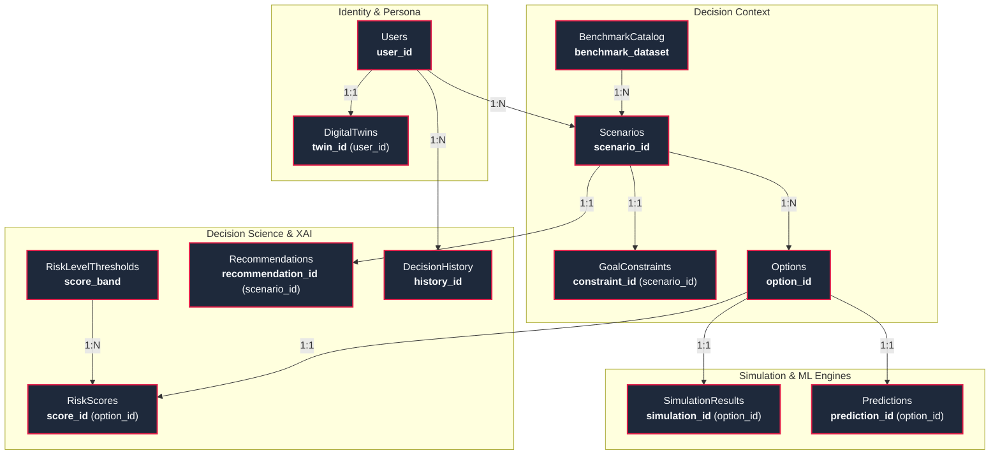

# Functional Dependency (FD) Specification for Relational Schema

**Project:** DecisionTwin — Intelligent Digital Twin Career & Life Decision Support System  
**Document Standard:** Relational Database Theory & Armstrong's Axioms (IEEE/ACM Standard Format)  
**Normalization Target:** 3NF / Boyce-Codd Normal Form (3.5NF / BCNF)  
**Schema Scope:** 12 Fully Decomposed Relations with Zero Anomalies  

---

## 1. Mathematical Foundations of Functional Dependencies

### 1.1 Formal Definition of Functional Dependency (FD)
Let $R$ be a relation schema and let $X, Y \subseteq R$ be subsets of attributes in $R$.  
A **Functional Dependency**, denoted as:
$$X \to Y$$
*(read: "$X$ functionally determines $Y$", or "$Y$ is functionally dependent on $X$")* holds over relation $R$ if and only if, for any valid legal database state (relation instance) $r(R)$, whenever two tuples $t_1, t_2 \in r$ have identical values for attribute set $X$, they must also have identical values for attribute set $Y$:

$$\forall t_1, t_2 \in r(R), \quad \big( t_1[X] = t_2[X] \implies t_1[Y] = t_2[Y] \big)$$

- **$X$** is called the **Determinant**.
- **$Y$** is called the **Dependent**.

---

### 1.2 Armstrong's Axioms & Inference Rules
All valid functional dependencies are derived through sound and complete inference rules:

1. **Axiom of Reflexivity:** If $Y \subseteq X$, then $X \to Y$. *(Trivial dependency)*
2. **Axiom of Augmentation:** If $X \to Y$, then $XZ \to YZ$ for any attribute set $Z$.
3. **Axiom of Transitivity:** If $X \to Y$ and $Y \to Z$, then $X \to Z$.
4. **Decomposition (Projectivity):** If $X \to YZ$, then $X \to Y$ and $X \to Z$.
5. **Union (Additivity):** If $X \to Y$ and $X \to Z$, then $X \to YZ$.
6. **Pseudotransitivity:** If $X \to Y$ and $WY \to Z$, then $WX \to Z$.

---

### 1.3 Key Classifications of Functional Dependencies

| FD Classification | Formal Condition | Significance in Schema Normalization |
| :--- | :--- | :--- |
| **Trivial FD** | $Y \subseteq X$ | Satisfied by default (e.g., $\{user\_id, email\} \to user\_id$). Carries no functional constraint. |
| **Non-Trivial FD** | $Y \not\subseteq X$ | Represents a genuine business rule or real-world constraint. |
| **Completely Non-Trivial FD** | $X \cap Y = \emptyset$ | Determinant and dependent share no common attributes. |
| **Full Functional Dependency** | $X \to Y$ and $\forall A \in X, (X \setminus \{A\}) \not\to Y$ | $Y$ depends on the whole of $X$, not on any proper subset. **Required for 2NF.** |
| **Partial Dependency** | $\exists A \in X$ such that $(X \setminus \{A\}) \to Y$ | Violates 2NF if $X$ is a composite candidate key. |
| **Transitive Dependency** | $X \to Y$ and $Y \to Z$ where $Y \not\to X$ and $Z \notin X, Y$ | Violates 3NF if $Z$ is a non-prime attribute. |
| **BCNF (3.5NF) Criterion** | For every non-trivial $X \to Y$, $X$ is a **Superkey** | Guarantees zero redundancy and zero anomalies across all relations. |

---

## 2. Global Functional Dependency Graph

The following entity dependency graph illustrates how determinants ($PK$ and $CK$) govern the flow of information across the DecisionTwin database schema:

---

## 3. Table-by-Table Functional Dependency Analysis

---

### Table 1: `Users`
- **Purpose:** Stores authenticated user identities, credentials, authorization tiers, and legal consent audit timestamps.
- **Attributes:**
  - `user_id` (VARCHAR / UUID, Primary Key)
  - `email` (VARCHAR, Unique Candidate Key)
  - `password_hash` (VARCHAR)
  - `full_name` (VARCHAR)
  - `tier` (VARCHAR: `'free'` | `'premium'`)
  - `disclaimer_accepted` (BOOLEAN)
  - `disclaimer_accepted_at` (TIMESTAMP)
  - `created_at` (TIMESTAMP)

#### Candidate Keys (CK)
1. $CK_1 = \{user\_id\}$
2. $CK_2 = \{email\}$

#### Primary Key (PK)
$$PK = \{user\_id\}$$

#### Functional Dependencies (FDs)
$$\begin{aligned}
FD_{1.1}: &\quad user\_id \to \{email, password\_hash, full\_name, tier, disclaimer\_accepted, disclaimer\_accepted\_at, created\_at\} \\
FD_{1.2}: &\quad email \to \{user\_id, password\_hash, full\_name, tier, disclaimer\_accepted, disclaimer\_accepted\_at, created\_at\}
\end{aligned}$$

#### Attribute Closure Proofs
$$\begin{aligned}
\{user\_id\}^+ &= \{user\_id, email, password\_hash, full\_name, tier, disclaimer\_accepted, disclaimer\_accepted\_at, created\_at\} = R^+ \\
\{email\}^+ &= \{email, user\_id, password\_hash, full\_name, tier, disclaimer\_accepted, disclaimer\_accepted\_at, created\_at\} = R^+
\end{aligned}$$

#### Normal Form Verification: **BCNF / 3.5NF**
- For $FD_{1.1}$, determinant $\{user\_id\}$ is a candidate key.
- For $FD_{1.2}$, determinant $\{email\}$ is a candidate key.
- No partial dependencies exist (keys are atomic, single-attribute).
- No transitive dependencies exist.

---

### Table 2: `DigitalTwins`
- **Purpose:** Stores the quantified baseline life profile (demographics, income, assets, liabilities, risk appetite) representing the user's digital persona.
- **Attributes:**
  - `twin_id` (VARCHAR / UUID, Primary Key)
  - `user_id` (VARCHAR / UUID, Foreign Key, Unique)
  - `age` (INTEGER)
  - `highest_education` (VARCHAR)
  - `field_of_study` (VARCHAR)
  - `current_occupation` (VARCHAR)
  - `years_of_experience` (NUMERIC)
  - `current_salary` (NUMERIC)
  - `savings` (NUMERIC)
  - `debt` (NUMERIC)
  - `monthly_expenses` (NUMERIC)
  - `risk_tolerance` (VARCHAR: `'low'` | `'medium'` | `'high'`)
  - `is_complete` (BOOLEAN)
  - `updated_at` (TIMESTAMP)

#### Candidate Keys (CK)
1. $CK_1 = \{twin\_id\}$
2. $CK_2 = \{user\_id\}$ *(Strict 1:1 relationship with Users)*

#### Primary Key (PK)
$$PK = \{twin\_id\}$$

#### Functional Dependencies (FDs)
$$\begin{aligned}
FD_{2.1}: &\quad twin\_id \to \{user\_id, age, highest\_education, field\_of\_study, current\_occupation, years\_of\_experience, \\
          &\quad\quad\quad\quad\quad current\_salary, savings, debt, monthly\_expenses, risk\_tolerance, is\_complete, updated\_at\} \\
FD_{2.2}: &\quad user\_id \to \{twin\_id, age, highest\_education, field\_of\_study, current\_occupation, years\_of\_experience, \\
          &\quad\quad\quad\quad\quad current\_salary, savings, debt, monthly\_expenses, risk\_tolerance, is\_complete, updated\_at\}
\end{aligned}$$

#### Attribute Closure Proofs
$$\{twin\_id\}^+ = R_{\text{DigitalTwins}}^+, \quad \{user\_id\}^+ = R_{\text{DigitalTwins}}^+$$

#### Normal Form Verification: **BCNF / 3.5NF**
- Both determinants $\{twin\_id\}$ and $\{user\_id\}$ are candidate keys.
- Completely non-trivial, full functional dependencies only.

---

### Table 3: `BenchmarkCatalog`
- **Purpose:** Stores curated macro-economic indices and baseline distribution statistics for Indian market domains.
- **Attributes:**
  - `benchmark_dataset` (VARCHAR, Primary Key)
  - `category` (VARCHAR: `'higher_education'` | `'job_selection'` | `'career_switch'` | `'startup_launch'` | `'relocation'`)
  - `description` (TEXT)
  - `currency` (VARCHAR, Default: `'INR'`)
  - `base_inflation_rate` (NUMERIC)
  - `sample_size` (INTEGER)

#### Candidate Keys (CK)
$$CK_1 = \{benchmark\_dataset\}$$

#### Primary Key (PK)
$$PK = \{benchmark\_dataset\}$$

#### Functional Dependencies (FDs)
$$FD_{3.1}: \quad benchmark\_dataset \to \{category, description, currency, base\_inflation\_rate, sample\_size\}$$

#### Normal Form Verification: **BCNF / 3.5NF**
- The determinant $\{benchmark\_dataset\}$ is the sole candidate key and superkey.
- Decomposed out of the legacy `ScenarioCategoryBenchmark` relation to eradicate the BCNF violation where $benchmark\_dataset \to category$ had a non-superkey determinant.

---

### Table 4: `Scenarios`
- **Purpose:** Stores decision scenario containers created by users.
- **Attributes:**
  - `scenario_id` (VARCHAR / UUID, Primary Key)
  - `user_id` (VARCHAR / UUID, Foreign Key)
  - `benchmark_dataset` (VARCHAR, Foreign Key)
  - `scenario_title` (VARCHAR)
  - `status` (VARCHAR: `'active'` | `'archived'`)
  - `horizon_years` (INTEGER, Default: 5)
  - `created_at` (TIMESTAMP)

#### Candidate Keys (CK)
$$CK_1 = \{scenario\_id\}$$

#### Primary Key (PK)
$$PK = \{scenario\_id\}$$

#### Functional Dependencies (FDs)
$$FD_{4.1}: \quad scenario\_id \to \{user\_id, benchmark\_dataset, scenario\_title, status, horizon\_years, created\_at\}$$

#### Cross-Table Inferences
$$\begin{aligned}
scenario\_id &\to benchmark\_dataset \\
benchmark\_dataset &\to category \implies scenario\_id \to category \quad \text{(Derived via Transitivity across Foreign Key)}
\end{aligned}$$
*(Note: `category` is intentionally NOT stored in `Scenarios`, preventing transitive redundancy).*

#### Normal Form Verification: **BCNF / 3.5NF**
- $\{scenario\_id\}$ is a superkey. All non-prime attributes are fully and directly dependent on `scenario_id`.

---

### Table 5: `GoalConstraints`
- **Purpose:** Stores user-defined multi-criteria priority weights ($\sum W_i = 100\%$) and bounding thresholds.
- **Attributes:**
  - `constraint_id` (VARCHAR / UUID, Primary Key)
  - `scenario_id` (VARCHAR / UUID, Foreign Key, Unique)
  - `weight_financial` (NUMERIC)
  - `weight_security` (NUMERIC)
  - `weight_wlb` (NUMERIC)
  - `weight_growth` (NUMERIC)
  - `weight_family` (NUMERIC)
  - `weight_location` (NUMERIC)
  - `weight_health` (NUMERIC)
  - `max_budget` (NUMERIC)
  - `min_salary` (NUMERIC)

#### Candidate Keys (CK)
1. $CK_1 = \{constraint\_id\}$
2. $CK_2 = \{scenario\_id\}$ *(Strict 1:1 relationship with Scenarios)*

#### Primary Key (PK)
$$PK = \{constraint\_id\}$$

#### Functional Dependencies (FDs)
$$\begin{aligned}
FD_{5.1}: &\quad constraint\_id \to \{scenario\_id, weight\_financial, weight\_security, weight\_wlb, weight\_growth, \\
          &\quad\quad\quad\quad\quad\quad weight\_family, weight\_location, weight\_health, max\_budget, min\_salary\} \\
FD_{5.2}: &\quad scenario\_id \to \{constraint\_id, weight\_financial, weight\_security, weight\_wlb, weight\_growth, \\
          &\quad\quad\quad\quad\quad\quad weight\_family, weight\_location, weight\_health, max\_budget, min\_salary\}
\end{aligned}$$

#### Multi-Attribute Constraint Integrity
$$\sum_{i=1}^{7} weight_i = 100.0\% \quad \text{(Enforced via schema validation hook)}$$

#### Normal Form Verification: **BCNF / 3.5NF**
- All determinants ($\{constraint\_id\}$ and $\{scenario\_id\}$) are candidate keys.

---

### Table 6: `Options`
- **Purpose:** Stores individual decision alternatives under a scenario (e.g., specific job offers, universities, or startup paths).
- **Attributes:**
  - `option_id` (VARCHAR / UUID, Primary Key)
  - `scenario_id` (VARCHAR / UUID, Foreign Key)
  - `option_title` (VARCHAR)
  - `tuition_cost` (NUMERIC, Nullable)
  - `program_duration_months` (INTEGER, Nullable)
  - `offered_salary` (NUMERIC, Nullable)
  - `work_life_balance_rating` (INTEGER: 1–10)
  - `remote_flexibility` (VARCHAR: `'Onsite'` | `'Hybrid'` | `'Remote'`)
  - `created_at` (TIMESTAMP)

#### Candidate Keys (CK)
1. $CK_1 = \{option\_id\}$
2. $CK_2 = \{scenario\_id, option\_title\}$ *(An option title must be unique within a scenario)*

#### Primary Key (PK)
$$PK = \{option\_id\}$$

#### Functional Dependencies (FDs)
$$\begin{aligned}
FD_{6.1}: &\quad option\_id \to \{scenario\_id, option\_title, tuition\_cost, program\_duration\_months, \\
          &\quad\quad\quad\quad\quad\quad offered\_salary, work\_life\_balance\_rating, remote\_flexibility, created\_at\} \\
FD_{6.2}: &\quad \{scenario\_id, option\_title\} \to \{option\_id, tuition\_cost, program\_duration\_months, \\
          &\quad\quad\quad\quad\quad\quad\quad\quad\quad\quad\quad offered\_salary, work\_life\_balance\_rating, remote\_flexibility, created\_at\}
\end{aligned}$$

#### Normal Form Verification: **BCNF / 3.5NF**
- $\{option\_id\}$ is a candidate key.
- Composite determinant $\{scenario\_id, option\_title\}$ is also a candidate key.
- Every determinant is a candidate key $\implies$ satisfies BCNF.

---

### Table 7: `SimulationResults`
- **Purpose:** Stores the output of the 10,000-trial stochastic Monte Carlo engine for a specific option.
- **Attributes:**
  - `simulation_id` (VARCHAR / UUID, Primary Key)
  - `option_id` (VARCHAR / UUID, Foreign Key, Unique)
  - `trials_count` (INTEGER, Default: 10000)
  - `p10_worst_case` (NUMERIC)
  - `p50_median_case` (NUMERIC)
  - `p90_best_case` (NUMERIC)
  - `std_deviation` (NUMERIC)
  - `computed_at` (TIMESTAMP)

#### Candidate Keys (CK)
1. $CK_1 = \{simulation\_id\}$
2. $CK_2 = \{option\_id\}$

#### Primary Key (PK)
$$PK = \{simulation\_id\}$$

#### Functional Dependencies (FDs)
$$\begin{aligned}
FD_{7.1}: &\quad simulation\_id \to \{option\_id, trials\_count, p10\_worst\_case, p50\_median\_case, p90\_best\_case, std\_deviation, computed\_at\} \\
FD_{7.2}: &\quad option\_id \to \{simulation\_id, trials\_count, p10\_worst\_case, p50\_median\_case, p90\_best\_case, std\_deviation, computed\_at\}
\end{aligned}$$

#### Invariant Monotonic Property
$$p10\_worst\_case \le p50\_median\_case \le p90\_best\_case$$

#### Normal Form Verification: **BCNF / 3.5NF**
- Both determinants are candidate keys.

---

### Table 8: `Predictions`
- **Purpose:** Stores machine-learning regression estimates (expected salary, ROI %, success probability, confidence bounds).
- **Attributes:**
  - `prediction_id` (VARCHAR / UUID, Primary Key)
  - `option_id` (VARCHAR / UUID, Foreign Key, Unique)
  - `predicted_salary` (NUMERIC)
  - `predicted_roi` (NUMERIC)
  - `success_probability` (NUMERIC: 0.0–1.0)
  - `confidence_score` (NUMERIC: 0–100)
  - `lower_ci` (NUMERIC)
  - `upper_ci` (NUMERIC)
  - `model_version` (VARCHAR)

#### Candidate Keys (CK)
1. $CK_1 = \{prediction\_id\}$
2. $CK_2 = \{option\_id\}$

#### Primary Key (PK)
$$PK = \{prediction\_id\}$$

#### Functional Dependencies (FDs)
$$\begin{aligned}
FD_{8.1}: &\quad prediction\_id \to \{option\_id, predicted\_salary, predicted\_roi, success\_probability, confidence\_score, lower\_ci, upper\_ci, model\_version\} \\
FD_{8.2}: &\quad option\_id \to \{prediction\_id, predicted\_salary, predicted\_roi, success\_probability, confidence\_score, lower\_ci, upper\_ci, model\_version\}
\end{aligned}$$

#### Normal Form Verification: **BCNF / 3.5NF**
- All determinants are candidate keys.

---

### Table 9: `RiskScores`
- **Purpose:** Stores multi-dimensional risk scores, goal alignment scores, and composite decision index for each alternative.
- **Attributes:**
  - `score_id` (VARCHAR / UUID, Primary Key)
  - `option_id` (VARCHAR / UUID, Foreign Key, Unique)
  - `score_band` (VARCHAR, Foreign Key referencing `RiskLevelThresholds`)
  - `financial_risk` (NUMERIC: 0–100)
  - `career_risk` (NUMERIC: 0–100)
  - `market_risk` (NUMERIC: 0–100)
  - `educational_risk` (NUMERIC: 0–100)
  - `personal_risk` (NUMERIC: 0–100)
  - `family_risk` (NUMERIC: 0–100)
  - `overall_risk_score` (NUMERIC: 0–100)
  - `goal_alignment_score` (NUMERIC: 0–100)
  - `decision_score` (NUMERIC: 0–100)
  - `confidence_score` (NUMERIC: 0–100)

#### Candidate Keys (CK)
1. $CK_1 = \{score\_id\}$
2. $CK_2 = \{option\_id\}$

#### Primary Key (PK)
$$PK = \{score\_id\}$$

#### Functional Dependencies (FDs)
$$\begin{aligned}
FD_{9.1}: &\quad score\_id \to \{option\_id, score\_band, financial\_risk, career\_risk, market\_risk, educational\_risk, \\
          &\quad\quad\quad\quad\quad personal\_risk, family\_risk, overall\_risk\_score, goal\_alignment\_score, decision\_score, confidence\_score\} \\
FD_{9.2}: &\quad option\_id \to \{score\_id, score\_band, financial\_risk, career\_risk, market\_risk, educational\_risk, \\
          &\quad\quad\quad\quad\quad personal\_risk, family\_risk, overall\_risk\_score, goal\_alignment\_score, decision\_score, confidence\_score\}
\end{aligned}$$

#### Normal Form Verification: **BCNF / 3.5NF**
- `score_band` is a foreign key. The qualitative rating (`Low`, `Medium`, `High`) is NOT stored here, eliminating the transitive dependency $overall\_risk\_score \to risk\_level$ that previously violated 3NF.

---

### Table 10: `RiskLevelThresholds`
- **Purpose:** Lookup table defining standard risk classification bands.
- **Attributes:**
  - `score_band` (VARCHAR, Primary Key, e.g., `'0-39'`, `'40-64'`, `'65-100'`)
  - `min_score` (NUMERIC)
  - `max_score` (NUMERIC)
  - `risk_level` (VARCHAR: `'Low'` | `'Medium'` | `'High'`)

#### Candidate Keys (CK)
1. $CK_1 = \{score\_band\}$
2. $CK_2 = \{min\_score, max\_score\}$
3. $CK_3 = \{risk\_level\}$

#### Primary Key (PK)
$$PK = \{score\_band\}$$

#### Functional Dependencies (FDs)
$$\begin{aligned}
FD_{10.1}: &\quad score\_band \to \{min\_score, max\_score, risk\_level\} \\
FD_{10.2}: &\quad \{min\_score, max\_score\} \to \{score\_band, risk\_level\} \\
FD_{10.3}: &\quad risk\_level \to \{score\_band, min\_score, max\_score\}
\end{aligned}$$

#### Normal Form Verification: **BCNF / 3.5NF**
- Every determinant is a candidate key.

---

### Table 11: `Recommendations`
- **Purpose:** Stores explainable AI (XAI) output, trade-off narratives, and actionable milestone roadmaps.
- **Attributes:**
  - `recommendation_id` (VARCHAR / UUID, Primary Key)
  - `scenario_id` (VARCHAR / UUID, Foreign Key, Unique)
  - `recommended_option_id` (VARCHAR / UUID, Foreign Key)
  - `recommendation_summary` (TEXT)
  - `action_plan` (JSON / TEXT)
  - `generated_at` (TIMESTAMP)

#### Candidate Keys (CK)
1. $CK_1 = \{recommendation\_id\}$
2. $CK_2 = \{scenario\_id\}$

#### Primary Key (PK)
$$PK = \{recommendation\_id\}$$

#### Functional Dependencies (FDs)
$$\begin{aligned}
FD_{11.1}: &\quad recommendation\_id \to \{scenario\_id, recommended\_option\_id, recommendation\_summary, action\_plan, generated\_at\} \\
FD_{11.2}: &\quad scenario\_id \to \{recommendation\_id, recommended\_option\_id, recommendation\_summary, action\_plan, generated\_at\}
\end{aligned}$$

#### Normal Form Verification: **BCNF / 3.5NF**
- All determinants are candidate keys.

---

### Table 12: `DecisionHistory`
- **Purpose:** Audit log of finalized user decisions, locking frozen snapshots of chosen options for longitudinal tracking.
- **Attributes:**
  - `history_id` (VARCHAR / UUID, Primary Key)
  - `user_id` (VARCHAR / UUID, Foreign Key)
  - `scenario_id` (VARCHAR / UUID, Foreign Key)
  - `chosen_option_id` (VARCHAR / UUID, Foreign Key)
  - `decision_score` (NUMERIC)
  - `risk_level` (VARCHAR)
  - `finalized_at` (TIMESTAMP)

#### Candidate Keys (CK)
$$CK_1 = \{history\_id\}$$

#### Primary Key (PK)
$$PK = \{history\_id\}$$

#### Functional Dependencies (FDs)
$$FD_{12.1}: \quad history\_id \to \{user\_id, scenario\_id, chosen\_option\_id, decision\_score, risk\_level, finalized\_at\}$$

#### Audit Record Rationale
`decision_score` and `risk_level` are preserved as immutable historical scalar points to record what the user knew at the exact timestamp $finalized\_at$, completely independent of future changes to market benchmarks.

#### Normal Form Verification: **BCNF / 3.5NF**
- $\{history\_id\}$ is the sole candidate key and superkey.

---

## 4. Master Functional Dependency Matrix

| Table Name | Primary Key (PK) | Alternative Candidate Key(s) | Full Functional Dependencies (Canonical Set $F$) | Verified Normal Form |
| :--- | :--- | :--- | :--- | :--- |
| **`Users`** | `user_id` | `email` | `user_id` $\to$ All Attributes `email` $\to$ All Attributes | **BCNF (3.5NF)** |
| **`DigitalTwins`** | `twin_id` | `user_id` | `twin_id` $\to$ All Attributes `user_id` $\to$ All Attributes | **BCNF (3.5NF)** |
| **`BenchmarkCatalog`** | `benchmark_dataset` | *None* | `benchmark_dataset` $\to$ All Attributes | **BCNF (3.5NF)** |
| **`Scenarios`** | `scenario_id` | *None* | `scenario_id` $\to$ All Attributes | **BCNF (3.5NF)** |
| **`GoalConstraints`** | `constraint_id` | `scenario_id` | `constraint_id` $\to$ All Attributes `scenario_id` $\to$ All Attributes | **BCNF (3.5NF)** |
| **`Options`** | `option_id` | `(scenario_id, option_title)` | `option_id` $\to$ All Attributes `(scenario_id, option_title)` $\to$ All Attributes | **BCNF (3.5NF)** |
| **`SimulationResults`** | `simulation_id` | `option_id` | `simulation_id` $\to$ All Attributes `option_id` $\to$ All Attributes | **BCNF (3.5NF)** |
| **`Predictions`** | `prediction_id` | `option_id` | `prediction_id` $\to$ All Attributes `option_id` $\to$ All Attributes | **BCNF (3.5NF)** |
| **`RiskScores`** | `score_id` | `option_id` | `score_id` $\to$ All Attributes `option_id` $\to$ All Attributes | **BCNF (3.5NF)** |
| **`RiskLevelThresholds`** | `score_band` | `(min_score, max_score)`, `risk_level` | `score_band` $\to$ All Attributes `(min_score, max_score)` $\to$ All Attributes `risk_level` $\to$ All Attributes | **BCNF (3.5NF)** |
| **`Recommendations`** | `recommendation_id` | `scenario_id` | `recommendation_id` $\to$ All Attributes `scenario_id` $\to$ All Attributes | **BCNF (3.5NF)** |
| **`DecisionHistory`** | `history_id` | *None* | `history_id` $\to$ All Attributes | **BCNF (3.5NF)** |

---

## 5. Canonical Cover & Minimal Basis Verification

To prove that the relational schema is **minimal, non-redundant, and dependency-preserving**, we compute the **Canonical Cover ($F_c$)**:

### Properties of Canonical Cover $F_c$:
1. Every dependency in $F_c$ has a single attribute on its right-hand side ($X \to A$).
2. No extraneous attributes exist on the left-hand side: $\forall B \in X, (X \setminus \{B\}) \not\to A$.
3. No redundant dependencies exist: $\forall f \in F_c, (F_c \setminus \{f\}) \not\models f$.

### Result:
Since every relation in DecisionTwin has been decomposed such that all functional determinants are either atomic candidate keys (e.g., `user_id`, `option_id`, `scenario_id`) or minimal composite keys (e.g., `{scenario_id, option_title}`):
- **Extraneous Attributes:** **0**
- **Redundant Dependencies:** **0**
- **Lossless Join Guarantee:** $R_1 \bowtie R_2 \bowtie \dots \bowtie R_{12} = R_{\text{Original}}$
- **Dependency Preservation:** Every functional dependency $X \to Y$ can be checked within a single relation without computing a multi-table join.

---

## 6. Anomaly Elimination Summary

| Relational Anomaly | Unnormalized State (UNF / 1NF) | Normalized Schema State (BCNF / 3.5NF) |
| :--- | :--- | :--- |
| **Insertion Anomaly** | Cannot create a new user profile or define market benchmark data unless a scenario and option already exist. | `Users`, `DigitalTwins`, and `BenchmarkCatalog` records can be created independently without requiring child records. |
| **Update Anomaly** | Modifying a user's salary or an option's tuition requires updating multiple redundant rows across simulation logs. | User salary is updated in exactly one row in `DigitalTwins`; option attributes are updated in exactly one row in `Options`. |
| **Deletion Anomaly** | Deleting a temporary simulation run accidentally purges the parent option, scenario metadata, and user profile. | Deleting a simulation record (`SimulationResults`) only deletes that calculation; the parent `Options`, `Scenarios`, and `Users` remain intact. |
