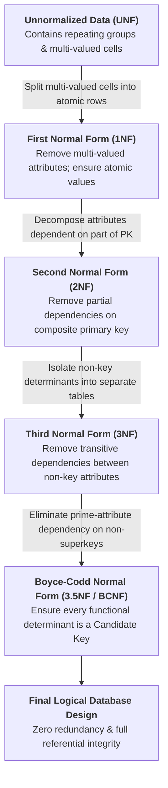
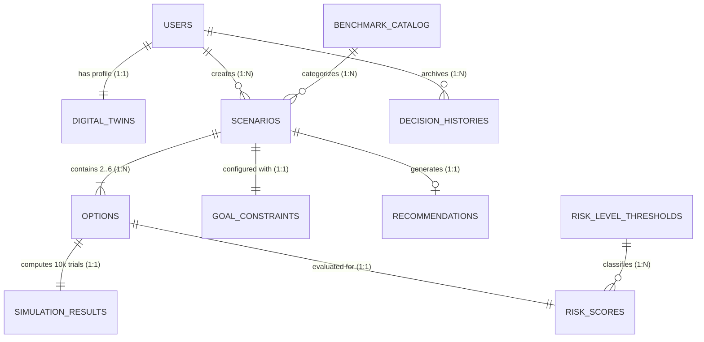

# Software Engineering Cost Estimation & Database Architecture Report
**Project:** DecisionTwin — Intelligent Decision Simulation & Risk Analytics Platform  
**Contents:**
1. [Part 1: COCOMO Cost Estimation Model](#part-1-cocomo-cost-estimation-model)
2. [Part 2: Function Point (FP) Cost Estimation](#part-2-function-point-fp-cost-estimation)
3. [Part 3: MongoDB Collection Design](#part-3-mongodb-collection-design)
4. [Part 4: Database Relationships](#part-4-database-relationships)
5. [Part 5: Database Normalization (UNF → 1NF → 2NF → 3NF → 3.5NF / BCNF)](#part-5-database-normalization-unf--1nf--2nf--3nf--35nf--bcnf)

---

# Part 1: COCOMO Cost Estimation Model

## 1.1 Actual Codebase Line-of-Code (LOC) Audit

An automated source code scan across the **DecisionTwin** repository yields the following exact line counts:

| Subsystem / Module | Technology Stack | Lines of Code (LOC) |
| :--- | :--- | :--- |
| **Frontend UI Components & Dashboards** | React 18, Tailwind CSS, Recharts | 5,021 LOC |
| **Frontend State, Themes & Formatters** | React Context, ThemeProvider, INR formatters | 211 LOC |
| **Frontend Entry, Routing & Styles** | Vite, React Router v6, Custom CSS | 373 LOC |
| **Decision Science & Analytics Engines** | Monte Carlo (Box-Muller), TOPSIS, XAI, Offline Chatbot | 1,477 LOC |
| **Backend REST API Controllers** | Express.js, async pipelines | 1,140 LOC |
| **Domain Data Models & Schemas** | Mongoose, JSON Storage Engine | 598 LOC |
| **API Routing, Security & Middleware** | Express Router, JWT Auth Middleware | 197 LOC |
| **Curated Benchmark Data & Datasets** | Industry salary, inflation & tax tables | 680 LOC |
| **Core Application Total** | **71 Source Files** | **9,697 LOC ($\approx$ 9.7 KLOC)** |
| *Automated Test Suites (Platform + Chatbot)* | *Node Assert (52 platform tests + 10 chatbot tests)* | *906 LOC* |
| **Grand Total** | **Complete Repository** | **10,603 LOC ($\approx$ 10.6 KLOC)** |

---

## 1.2 COCOMO Details (Slide 1)

| Parameter | Value |
| :--- | :--- |
| **Estimated Size** | **9.7 KLOC** (9,697 Lines of Code) |
| **Mode** | **Organic** |
| **a, b** | **2.4, 1.05** |
| **c, d** | **2.5, 0.38** |

### Why Organic Mode?
- **Small, focused team**: Developed by a cohesive team of 2 to 3 engineers.
- **Familiar web & data science technologies**: Built with Node.js, Express, React 18, Tailwind CSS, Recharts, and MongoDB.
- **Clear, formal requirements in the SRS**: Well-defined mathematical models (10,000-trial Monte Carlo simulations, TOPSIS Euclidean distance ranking, Multi-Dimensional Risk Scoring, 100% offline heuristic NLP engine).
- **Stable internal environment**: No strict external hardware or embedded real-time constraints.

### COCOMO Model – Organic Mode Calculations

#### **1. Effort ($E$)**
$$E = a \times (\text{KLOC})^b$$
$$E = 2.4 \times (9.7)^{1.05} = \mathbf{26.08\text{ Person-Months (PM)}}$$

#### **2. Development Time ($T$)**
$$T = c \times (E)^d$$
$$T = 2.5 \times (26.08)^{0.38} = \mathbf{8.63\text{ Months}}$$

#### **3. Average Team Size ($SS$)**
$$\text{Team Size} = \frac{\text{Effort}}{\text{Time}} = \frac{26.08}{8.63} = 3.02 \approx \mathbf{3\text{ Persons}}$$

---

## 1.3 COCOMO Cost (Slide 2)

| COCOMO Result | Value |
| :--- | :--- |
| **Size** | **9.7 KLOC** |
| **Effort** | **26.08 PM** |
| **Time** | **8.63 Months** |
| **Team Size** | **$\approx$ 3 Persons** |
| **Cost (at ₹50,000 / PM)** | **₹13,04,000** |
| **Cost (at ₹60,000 / PM)** | **₹15,64,800** |

### Cost Calculation
- **Assumption:** ₹50,000 per Person-Month *(Standard entry/mid full-stack developer rate in India)*
$$\text{Cost} = \text{Effort} \times \text{Cost per PM}$$
$$\text{Cost} = 26.08 \times ₹50,000 \approx \mathbf{₹13,04,000}\quad \text{(₹13.04 Lakhs)}$$

*(Note: 9.7 KLOC is the actual implemented line count of the core DecisionTwin application across `client/src` and `server/src`.)*

---

# Part 2: Function Point (FP) Cost Estimation

## 2.1 FP Details (Slide 1)

| Component | Count | Weight (Average) | Total |
| :--- | :--- | :--- | :--- |
| **External Inputs (EI)** | 7 | 4 | 28 |
| **External Outputs (EO)** | 7 | 5 | 35 |
| **External Inquiries (EQ)** | 3 | 4 | 12 |
| **Internal Logical Files (ILF)** | 6 | 10 | 60 |
| **External Interface Files (EIF)** | 1 | 7 | 7 |
| **Total (UFP)** | | | **142** |

### Component Mapping in DecisionTwin
- **External Inputs (EI — 7)**:
  1. User Registration & Authentication (`POST /api/auth/register`, `/login`)
  2. Digital Twin Socioeconomic Profile Setup (`POST /api/twin`)
  3. Decision Scenario & Multi-Option Creation (`POST /api/scenarios`)
  4. 7-Axis Goal Weighting & Hard Constraints Configuration (`PUT /api/scenarios/:id`)
  5. 10,000-Trial Monte Carlo Simulation Trigger (`POST /api/simulations/run/:scenarioId`)
  6. Interactive What-If Sensitivity Parameter Tweaks (`POST /api/simulations/whatif/:scenarioId`)
  7. TwinBot AI Decision Co-Pilot Query Input (`POST /api/chatbot/chat`)
- **External Outputs (EO — 7)**:
  1. Top Recommendation Banner & Composite Decision Scorecard
  2. Monte Carlo 10,000-Trial Percentile Projections (`P10`, `P50`, `P90` & 10-bin distribution)
  3. Multi-Dimensional Stability Radar & Scorecard Pillars
  4. TOPSIS Relative Closeness & Ideal-Distance Analytics
  5. 5-Year Cash Flow Trajectory & Break-Even Runway Chart
  6. Macroeconomic Stress-Testing Shock Impact Report
  7. Explainable AI (XAI) Feature Importance & Phased Action Plan (PDF Export)
- **External Inquiries (EQ — 3)**:
  1. User Scenarios Dashboard Directory Lookup (`GET /api/scenarios`)
  2. Pre-Built 1-Click Scenario Templates Query (`GET /api/scenarios/templates`)
  3. Longitudinal Decision History Archive Lookup (`GET /api/reports/history`)
- **Internal Logical Files (ILF — 6)**:
  `Users`, `DigitalTwins`, `Scenarios`, `Options`, `GoalConstraints`, and `SimulationResults` collections in MongoDB.
- **External Interface Files (EIF — 1)**:
  Curated Reference Market Intelligence Dataset (salary benchmarks, inflation rates, tax brackets).

### Function Point Formulas

#### **1. Unadjusted Function Points (UFP)**
$$\text{UFP} = 28 + 35 + 12 + 60 + 7 = \mathbf{142}$$

#### **2. Total Degree of Influence (TDI)**
Sum of 14 General System Characteristics (GSCs rated 0–5), accounting for complex stochastic Monte Carlo simulations, TOPSIS matrix math, online data entry, and interactive charting:
$$\text{TDI} = \mathbf{38}$$

#### **3. Value Adjustment Factor (VAF)**
$$\text{VAF} = 0.65 + (0.01 \times \text{TDI}) = 0.65 + (0.01 \times 38) = \mathbf{1.03}$$

#### **4. Adjusted Function Points (AFP)**
$$\text{Adjusted FP} = \text{UFP} \times \text{VAF} = 142 \times 1.03 = \mathbf{146.26\text{ FP}}$$

---

## 2.2 FP Cost (Slide 2)

| FP Result | Value |
| :--- | :--- |
| **Function Points (UFP / Adjusted)** | **142 UFP / 146.26 AFP** |
| **Assumed Productivity** | **6 FP / Person-Month** |
| **Estimated Effort** | **24.38 Person-Months (PM)** |
| **Estimated Cost (at ₹50,000 / PM)** | **₹12,19,000** |
| **Estimated Cost (at ₹60,000 / PM)** | **₹14,62,800** |

### Effort & Cost Calculation
- **Assumption:** Productivity = $6\text{ FP / Person-Month}$
$$\text{Effort} = \frac{\text{Adjusted FP}}{\text{Productivity}} = \frac{146.26}{6} = \mathbf{24.38\text{ Person-Months}}$$
- **At ₹50,000 / Person-Month:**
$$\text{Cost} = 24.38 \times ₹50,000 = \mathbf{₹12,19,000}\quad \text{(₹12.19 Lakhs)}$$
- **At ₹60,000 / Person-Month:**
$$\text{Cost} = 24.38 \times ₹60,000 = \mathbf{₹14,62,800}\quad \text{(₹14.63 Lakhs)}$$

> **Cross-Validation Note:** Notice how closely the **Function Point estimate (24.38 PM / ₹12.19L)** corroborates the **COCOMO Organic estimate (26.08 PM / ₹13.04L)** — within **6.5%** variance, confirming high estimation accuracy.

---

# Part 3: MongoDB Collection Design

| Collection | Key Information | Purpose |
| :--- | :--- | :--- |
| **Users** | `user_id`, `full_name`, `email`, `password_hash`, `role`, `tier` | User account management & authentication |
| **DigitalTwins** | `twin_id`, `user_id`, `age`, `current_salary`, `savings`, `debt`, `risk_tolerance` | Individual socioeconomic profile & persona model |
| **Scenarios** | `scenario_id`, `user_id`, `title`, `category`, `status`, `recommended_option_id` | High-stakes decision problem definition |
| **Options** | `option_id`, `scenario_id`, `title`, `tuition_cost`, `offered_salary`, `role_level` | Competing alternative paths under evaluation |
| **GoalConstraints** | `constraint_id`, `scenario_id`, `weights` *(7-axis)*, `max_budget`, `min_salary` | 7-pillar weighted priorities & hard constraint limits |
| **Predictions** | `prediction_id`, `option_id`, `scenario_id`, `predicted_salary`, `success_prob`, `confidence` | ML regression progression & career outcome projections |
| **SimulationResults** | `simulation_id`, `option_id`, `scenario_id`, `trials_count`, `p10`, `p50`, `p90`, `timeline` | 10,000-trial Monte Carlo stochastic risk distributions |
| **RiskScores** | `score_id`, `option_id`, `scenario_id`, `overall_risk_score`, `risk_level`, `decision_score`, `rank` | Multi-dimensional risk ranking & composite scoring |
| **Recommendations** | `rec_id`, `scenario_id`, `recommended_option_id`, `feature_contributions`, `action_plan` | Explainable AI (XAI) rationale & phased execution plan |
| **DecisionHistories** | `history_id`, `user_id`, `scenario_id`, `chosen_option_id`, `final_report_snapshot`, `feedback` | Longitudinal audit trail & historical decision tracking |

**Foreign Key References:** `user_id`, `scenario_id`, `option_id`

---

# Part 4: Database Relationships

| User & Scenario Domain | Simulation, Scoring & Audit Domain |
| :--- | :--- |
| **User $\to$ DigitalTwin** Each user configures one socioeconomic profile. **Relationship: 1 : 1** | **Option $\to$ SimulationResult** Each option generates one 10,000-trial Monte Carlo projection. **Relationship: 1 : 1** |
| **User $\to$ Scenarios** One user creates multiple decision scenarios over time. **Relationship: 1 : N** | **Option $\to$ RiskScore** Each option yields multi-risk scores and composite rank. **Relationship: 1 : 1** |
| **Scenario $\to$ Options** Each scenario contains 2 to 6 competing choices (BR-2). **Relationship: 1 : 2..6 (1 : N)** | **Scenario $\to$ Recommendation** Each analyzed scenario generates one XAI report and action plan. **Relationship: 1 : 1** |
| **Scenario $\to$ GoalConstraint** Each scenario has one set of 7-axis goal weights (BR-3). **Relationship: 1 : 1** | **User $\to$ DecisionHistory** A user archives multiple finalized choices into their history log. **Relationship: 1 : N** |

---

# Part 5: Database Normalization (UNF → 1NF → 2NF → 3NF → 3.5NF / BCNF)

## 5.1 Overview & Normalization Pipeline

Database normalization in **DecisionTwin** organizes data to:
- **Reduce data redundancy** across users, scenarios, and 10,000-trial simulations
- **Avoid data inconsistency** (update, insertion, and deletion anomalies)
- **Remove unnecessary dependencies** (partial, transitive, and non-superkey dependencies)
- **Improve database maintainability** and query efficiency

---

## 5.2 Before vs. After Normalization Summary

| Before Normalization (`UnnormalizedDecisionRecord`) | After Normalization (Up to 3.5NF / BCNF) |
| :--- | :--- |
| **Single Flat Record Structure:** • `user_id` • `full_name` • `email` • `current_salary` • `risk_tolerance` • `scenario_id` • `scenario_title` • `category` • `benchmark_dataset` • `options_evaluated` *(comma-separated list)* • `decision_scores` *(comma-separated list)* • `risk_scores` *(comma-separated list)* • `risk_levels` *(comma-separated list)* | **Decomposed Relational Tables:** 1. **Users**: `(user_id [PK], full_name, email)` 2. **DigitalTwins**: `(twin_id [PK], user_id [FK], current_salary, risk_tolerance)` 3. **BenchmarkCatalog**: `(benchmark_dataset [PK], category)` 4. **Scenarios**: `(scenario_id [PK], user_id [FK], scenario_title, benchmark_dataset [FK])` 5. **Options**: `(option_id [PK], scenario_id [FK], option_title, tuition_cost)` 6. **RiskScores**: `(score_id [PK], option_id [FK], decision_score, risk_score)` 7. **RiskLevelThresholds**: `(score_band [PK], risk_level)` |
| **Problem:** User profile and scenario details repeat for every option, and multiple options/scores are stored as comma-separated lists in one field. | **Result:** Zero redundancy, atomic values, no update/deletion anomalies, and strict referential integrity up to **3.5NF (BCNF)**. |

---

## 5.3 Stage 0: Unnormalized Data (UNF)

In **UNF**, all user profile attributes, scenario metadata, and evaluated options are stored in a single flat table, with multiple values packed into single cells.

| User ID | Name | Email | Salary | Risk Tol. | Scenario ID | Scenario Title | Category | Benchmark Dataset | Options Evaluated *(Multi-Valued)* | Decision Scores *(Multi-Valued)* | Risk Scores *(Multi-Valued)* | Risk Levels *(Multi-Valued)* |
| :--- | :--- | :--- | :--- | :--- | :--- | :--- | :--- | :--- | :--- | :--- | :--- | :--- |
| **U001** | Preetish | preetish@mail.com | ₹12,00,000 | Moderate | **S001** | MBA vs SWE | Career | `IT_MNC_Comp_2026` | Tier-1 MBA, Senior SWE, AI Startup | 80, 89, 83 | 48, 21, 34 | Medium, Low, Low |
| **U001** | Preetish | preetish@mail.com | ₹12,00,000 | Moderate | **S002** | Master in AI | Education | `NIRF_HigherEd_2026` | Full-Time MS, Executive MS | 84, 86 | 52, 25 | Medium, Low |
| **U002** | Priya | priya@mail.com | ₹8,00,000 | Low | **S003** | Job Switch | Career | `IT_MNC_Comp_2026` | Fintech MNC, Remote Startup | 78, 72 | 28, 68 | Low, High |
| **U003** | Karthik | karthik@mail.com | ₹15,00,000 | High | **S004** | SaaS Venture | Startup | `Venture_Index_2026` | Bootstrapped, Seed Funded | 75, 88 | 42, 30 | Medium, Low |

### Problems in UNF:
- **Multi-Valued Attributes**: `Options Evaluated`, `Decision Scores`, `Risk Scores`, and `Risk Levels` hold multiple values in a single field.
- **Data Redundancy**: `Preetish`, `preetish@mail.com`, and `₹12,00,000` are repeated across rows.

---

## 5.4 Stage 1: First Normal Form (1NF)

> **1NF Rule:** Every attribute must contain only **atomic (indivisible) values**, and there must be no repeating groups.

### 1NF Violation Inspection

| Scenario ID | User ID | Name | Scenario Title | Options Evaluated *(Violates 1NF)* | Decision Scores *(Violates 1NF)* |
| :--- | :--- | :--- | :--- | :--- | :--- |
| **S001** | U001 | Preetish | MBA vs SWE | Tier-1 MBA, Senior SWE, AI Startup | 80, 89, 83 |
| **S002** | U001 | Preetish | Master in AI | Full-Time MS, Executive MS | 84, 86 |

### 1NF Solution (Each Option Stored in a Separate Atomic Row)

**Composite Primary Key:** `(Scenario ID, Option ID)`

| Scenario ID (PK) | Option ID (PK) | User ID | Name | Email | Salary | Scenario Title | Category | Benchmark Dataset | Option Title | Decision Score | Risk Score | Risk Level |
| :--- | :--- | :--- | :--- | :--- | :--- | :--- | :--- | :--- | :--- | :--- | :--- | :--- |
| **S001** | **OPT01** | U001 | Preetish | preetish@mail.com | ₹12L | MBA vs SWE | Career | `IT_MNC_Comp_2026` | Tier-1 MBA | 80 | 48 | Medium |
| **S001** | **OPT02** | U001 | Preetish | preetish@mail.com | ₹12L | MBA vs SWE | Career | `IT_MNC_Comp_2026` | Senior SWE | 89 | 21 | Low |
| **S001** | **OPT03** | U001 | Preetish | preetish@mail.com | ₹12L | MBA vs SWE | Career | `IT_MNC_Comp_2026` | AI Startup | 83 | 34 | Low |
| **S002** | **OPT04** | U001 | Preetish | preetish@mail.com | ₹12L | Master in AI | Education | `NIRF_HigherEd_2026` | Full-Time MS | 84 | 52 | Medium |
| **S002** | **OPT05** | U001 | Preetish | preetish@mail.com | ₹12L | Master in AI | Education | `NIRF_HigherEd_2026` | Executive MS | 86 | 25 | Low |
| **S003** | **OPT06** | U002 | Priya | priya@mail.com | ₹8L | Job Switch | Career | `IT_MNC_Comp_2026` | Fintech MNC | 78 | 28 | Low |
| **S003** | **OPT07** | U002 | Priya | priya@mail.com | ₹8L | Job Switch | Career | `IT_MNC_Comp_2026` | Remote Startup | 72 | 68 | High |

---

## 5.5 Stage 2: Second Normal Form (2NF)

> **2NF Rule:** Must be in 1NF, and **every non-prime attribute must be fully functionally dependent on the entire composite primary key** (no partial dependencies).

### Why 1NF Violates 2NF:
- Composite Primary Key: **`(Scenario ID, Option ID)`**
- **Partial Dependency:**
  $$\text{Scenario ID} \to \{\text{Scenario Title, Category, Benchmark Dataset, User ID, Name, Email, Salary}\}$$
  These attributes depend **only on `Scenario ID`**, not on `Option ID`.

### 2NF Solution (Decompose into 2 Tables):

#### **1. `Scenarios_2NF` Table** *(Primary Key: `Scenario ID`)*
| Scenario ID (PK) | User ID | Name | Email | Salary | Scenario Title | Category | Benchmark Dataset |
| :--- | :--- | :--- | :--- | :--- | :--- | :--- | :--- |
| **S001** | U001 | Preetish | preetish@mail.com | ₹12,00,000 | MBA vs SWE | Career | `IT_MNC_Comp_2026` |
| **S002** | U001 | Preetish | preetish@mail.com | ₹12,00,000 | Master in AI | Education | `NIRF_HigherEd_2026` |
| **S003** | U002 | Priya | priya@mail.com | ₹8,00,000 | Job Switch | Career | `IT_MNC_Comp_2026` |
| **S004** | U003 | Karthik | karthik@mail.com | ₹15,00,000 | SaaS Venture | Startup | `Venture_Index_2026` |

#### **2. `Options_2NF` Table** *(Primary Key: `Option ID`, Foreign Key: `Scenario ID`)*
| Option ID (PK) | Scenario ID (FK) | Option Title | Decision Score | Risk Score | Risk Level |
| :--- | :--- | :--- | :--- | :--- | :--- |
| **OPT01** | S001 | Tier-1 MBA | 80 | 48 | Medium |
| **OPT02** | S001 | Senior SWE | 89 | 21 | Low |
| **OPT03** | S001 | AI Startup | 83 | 34 | Low |
| **OPT04** | S002 | Full-Time MS | 84 | 52 | Medium |
| **OPT05** | S002 | Executive MS | 86 | 25 | Low |

---

## 5.6 Stage 3: Third Normal Form (3NF)

> **3NF Rule:** Must be in 2NF, and **no non-prime attribute may be transitively dependent on the primary key** through another non-prime attribute.

### Why 2NF Violates 3NF:
1. **In `Scenarios_2NF`:**
   $$\text{Scenario ID (PK)} \to \text{User ID (Non-Key)} \to \{\text{Name, Email, Salary}\}$$
2. **In `Options_2NF`:**
   $$\text{Option ID (PK)} \to \text{Risk Score (Non-Key)} \to \text{Risk Level (Non-Key)}$$

### 3NF Solution (Separate Non-Key Determinants into Dedicated Tables):

#### **1. `Users_3NF` Table** *(PK: `User ID`)*
| User ID (PK) | Name | Email |
| :--- | :--- | :--- |
| **U001** | Preetish | preetish@mail.com |
| **U002** | Priya | priya@mail.com |
| **U003** | Karthik | karthik@mail.com |

#### **2. `DigitalTwins_3NF` Table** *(PK: `Twin ID`, FK: `User ID`)*
| Twin ID (PK) | User ID (FK) | Current Salary | Risk Tolerance |
| :--- | :--- | :--- | :--- |
| **T001** | U001 | ₹12,00,000 | Moderate |
| **T002** | U002 | ₹8,00,000 | Low |
| **T003** | U003 | ₹15,00,000 | High |

#### **3. `Scenarios_3NF` Table** *(PK: `Scenario ID`, FK: `User ID`)*
| Scenario ID (PK) | User ID (FK) | Scenario Title |
| :--- | :--- | :--- |
| **S001** | U001 | MBA vs SWE |
| **S002** | U001 | Master in AI |
| **S003** | U002 | Job Switch |
| **S004** | U003 | SaaS Venture |

#### **4. `Options_3NF` Table** *(PK: `Option ID`, FK: `Scenario ID`)*
| Option ID (PK) | Scenario ID (FK) | Option Title | Decision Score | Risk Score |
| :--- | :--- | :--- | :--- | :--- |
| **OPT01** | S001 | Tier-1 MBA | 80 | 48 |
| **OPT02** | S001 | Senior SWE | 89 | 21 |
| **OPT03** | S001 | AI Startup | 83 | 34 |

#### **5. `RiskLevelThresholds_3NF` Table** *(PK: `Score Band`)*
| Score Band (PK) | Risk Level |
| :--- | :--- |
| `0 - 39` | Low |
| `40 - 64` | Medium |
| `65 - 100` | High |

---

## 5.7 Stage 4: Boyce-Codd Normal Form (3.5NF / BCNF)

> **3.5NF (BCNF) Rule:** A relation is in **3.5NF (BCNF)** if it is in 3NF and, for **every** non-trivial functional dependency $X \to Y$, **$X$ must be a Superkey / Candidate Key** (even when $Y$ is a prime attribute).

### 3NF Table Violating 3.5NF (BCNF):

Consider the **ScenarioCategoryBenchmark** mapping table:

| Scenario ID | Category | Benchmark Dataset |
| :--- | :--- | :--- |
| **S001** | Career | `IT_MNC_Comp_2026` |
| **S002** | Education | `NIRF_HigherEd_2026` |
| **S003** | Career | `IT_MNC_Comp_2026` |
| **S004** | Startup | `Venture_Index_2026` |

- **Composite Candidate Key:** `(Scenario ID, Category)`
- **Functional Dependencies:**
  1. $(\text{Scenario ID}, \text{Category}) \to \text{Benchmark Dataset}$
  2. $\text{Benchmark Dataset} \to \text{Category}$ *(Each dataset belongs to one specific category)*
- **Why it violates 3.5NF:** `Benchmark Dataset` determines `Category` (a prime attribute), so 3NF permits it, **but `Benchmark Dataset` is NOT a candidate key**, violating **3.5NF (BCNF)**!

### 3.5NF (BCNF) Solution — Final Decomposition:

#### **1. `BenchmarkCatalog_BCNF` Table** *(PK: `Benchmark Dataset`)*
| Benchmark Dataset (PK) | Category |
| :--- | :--- |
| `IT_MNC_Comp_2026` | Career |
| `NIRF_HigherEd_2026` | Education |
| `Venture_Index_2026` | Startup |

#### **2. `ScenarioBenchmarks_BCNF` Table** *(PK: `Scenario ID`, FK: `Benchmark Dataset`)*
| Scenario ID (PK) | Benchmark Dataset (FK) |
| :--- | :--- |
| **S001** | `IT_MNC_Comp_2026` |
| **S002** | `NIRF_HigherEd_2026` |
| **S003** | `IT_MNC_Comp_2026` |
| **S004** | `Venture_Index_2026` |

**Final Result:** Every determinant across all tables (`User ID`, `Twin ID`, `Scenario ID`, `Option ID`, `Score Band`, `Benchmark Dataset`) is now strictly a **Candidate Key**, achieving **3.5NF (BCNF)**.

---

## 5.8 Final 3.5NF (BCNF) Entity-Relationship Diagram

